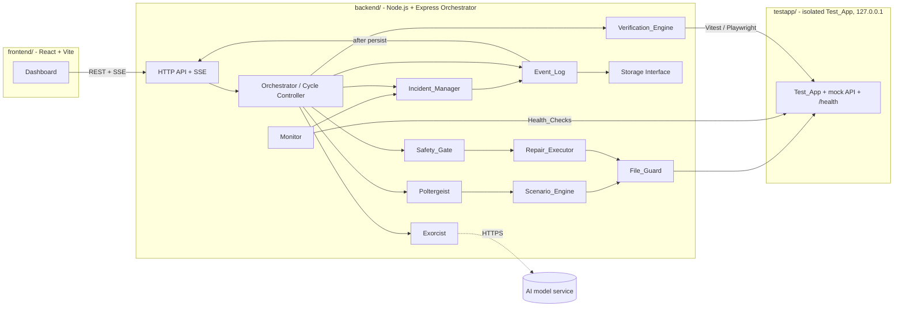
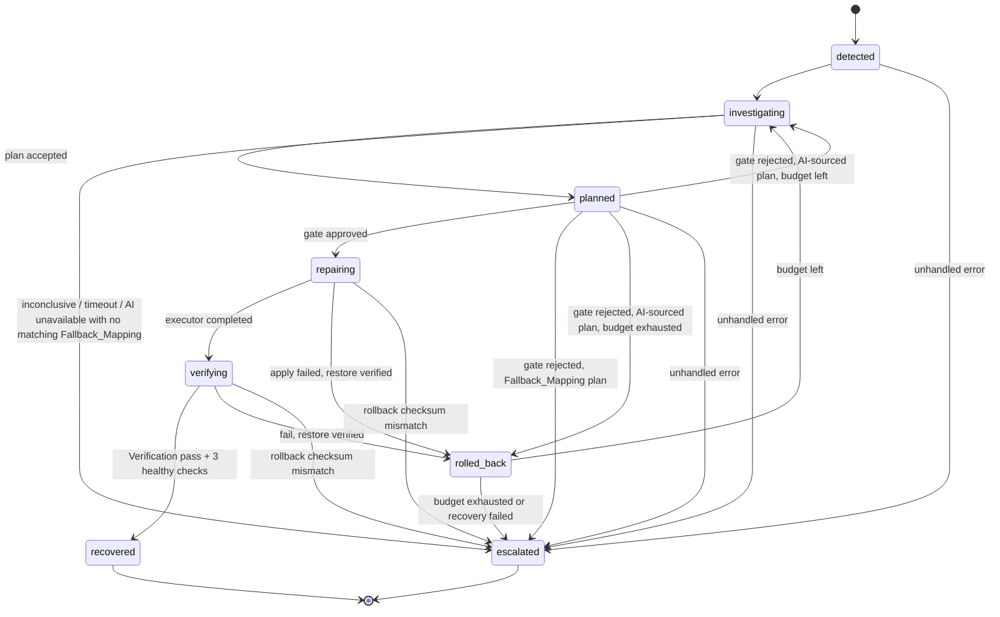
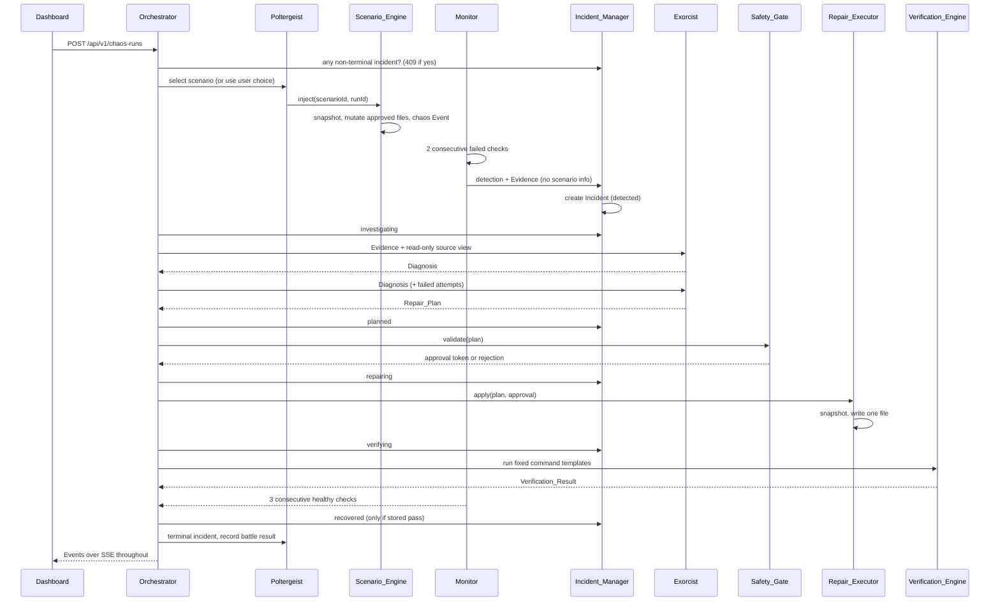

# Design Document

## Overview

This document describes the design of Poltergeist QA vs. The Exorcist, a local demo of an autonomous chaos and self-healing loop. It covers architecture, module interfaces, data models, correctness properties, error handling and testing. It contains no implementation code.

The design follows these principles, taken from the workspace steering rules and requirements:

1. **Separation of concerns.** `frontend/` (Aathavan), `backend/` (Dhanashri) and the Test_App directory are independent. Inside `backend/`, the Poltergeist, Exorcist, Safety_Gate, Repair_Executor, Monitor, Verification_Engine and Incident_Manager are separate modules that talk only through interfaces defined in one shared contracts module (Requirements 13.8, 20.1, 20.2).
2. **Agents propose, deterministic code disposes.** The AI agents only produce structured data (a scenario choice, a Diagnosis, a Repair_Plan). Every write to a file is performed by deterministic code (Scenario_Engine or Repair_Executor) behind validation (Requirements 4.3, 7.3, 9.9).
3. **No false success.** `recovered` can only be reached through a stored Verification_Result of `pass` plus three confirming Health_Checks. Dashboard state is derived only from Events and API responses (Requirements 11.7-11.9, 14.11).
4. **Information barrier.** Detection and diagnosis see only observable Evidence, never the chaos Events or scenario ID (Requirements 3.8, 5.2, 7.4).
5. **Reversibility.** Every file modification is preceded by a Snapshot and can be rolled back with checksum confirmation (Requirements 3.1, 10.2, 12.3, 17.7).
6. **No new dependencies without review.** The design names candidate technologies from the requirements (Node.js, Express, React, Vite, Vitest, Playwright, SSE). fast-check and Ajv are approved but are installed only during the implementation task that needs them, after review. Anything beyond that is a *proposal* in the dependency review (see Dependency Review).

### Research Summary

Findings that shaped the design:

- **Server-Sent Events** support resumption through the `Last-Event-ID` header and the `id:` field. The browser `EventSource` re-sends the last `id` after a reconnect, which maps directly to the sequence-number replay in Requirement 14.4 and 15.7. [MDN: Using server-sent events](https://developer.mozilla.org/en-US/docs/Web/API/Server-sent_events/Using_server-sent_events)
- **Atomic file replacement** via write-to-temp-then-rename is the standard way to avoid partial writes on a local file store, as required by Requirement 18.2. On Windows, rename over an existing file can fail while the target is open, so the storage layer must retry briefly and close handles before renaming. [Node.js fs documentation](https://nodejs.org/api/fs.html)
- **Safe command execution** is achieved by spawning a process with a fixed executable and an argument array, without a shell, so no agent text can be interpreted as a command (Requirement 17.6). [Node.js child_process](https://nodejs.org/api/child_process.html)
- **Path confinement** requires resolving symlinks with `realpath` before comparing against an allowlist, because a string-prefix check on an unresolved path can be bypassed (Requirement 9.2, 9.3).
- **Playwright** can collect console errors and take screenshots and DOM snapshots per page, which covers the Evidence in Requirement 5.4. [Playwright docs](https://playwright.dev/docs/api/class-page)

Content from these sources was rephrased for compliance with licensing restrictions.

### Key Design Decisions

| Decision | Rationale |
|---|---|
| Single-process Orchestrator with in-process modules behind interfaces | Simplest for a demo; interfaces keep modules replaceable and testable. |
| Event_Log is the source of truth, Incident records are projections that are also persisted | Satisfies "persist then publish" and lets the Dashboard rebuild state from Events. |
| Repair_Plan is declarative (`replace_text` style actions), not a diff or script | Enables deterministic Safety_Gate validation and rules out shell content. |
| Gate approval is a signed hash of the canonical plan | The executor can verify "approval for the same plan content" (Requirement 10.1) without trusting the caller. |
| Scenarios are injected by deterministic file transforms stored in the catalog | Reversible, checksummed, and never AI-generated. |
| Test processes run from fixed command templates | Prevents agent text from reaching a command line. |
| Monitor owns its own Playwright browser context and never reads chaos Events | Enforces independent detection. |

## Architecture

### System Context



The `testapp/` directory name is approved (Requirement 20.1).

### Proposed Directory Layout

```
frontend/                      React + Vite Dashboard (Aathavan)
backend/                       (Dhanashri)
  src/
    contracts/                 JSON schemas + type docs shared by modules (no logic)
    orchestrator/              cycle controller, retry budget, config loading
    api/                       Express routes, request validation, SSE endpoint
    poltergeist/               chaos agent (no imports from exorcist/)
    exorcist/                  diagnosis + planning agent (no imports from poltergeist/)
    scenario-engine/           catalog loader, injection, reversal
    monitor/                   health polling, debounce, evidence capture
    incident/                  Incident_Manager + state machine
    safety-gate/               deterministic plan validation
    repair-executor/           restricted writer, snapshots, rollback
    verification/              command templates, test runners, result aggregation
    events/                    Event_Log, sequencing, publisher, redactor
    storage/                   Storage interface + local JSON implementation
    file-guard/                path normalization and approved-path enforcement
  config/                      approved-files, action-allowlist, scenario-catalog,
                               command-templates (non-secret, versioned)
  storage-data/                runtime JSON (git-ignored)
  tests/
testapp/                       Test_App sources (the only mutable target)
docs/                          API, Event, Diagnosis, Repair_Plan, Catalog schemas;
                               dependency review
.kiro/                         agents, steering, specs, hooks
```

Import rules, enforced by a lightweight script in the test suite: `poltergeist/` and `exorcist/` import only from `contracts/`; `frontend/` imports nothing from `backend/`.

### Incident Lifecycle



Terminal states are `recovered` and `escalated`. `rolled_back` is transient. The Incident enters it only after the Rollback has restored the Approved_Files, the restored checksums equal the Snapshot checksums, and the rollback evidence is recorded. It then moves to `investigating` when attempts remain, or to `escalated` when the Retry_Budget is exhausted or recovery failed. If restored checksums differ, the Incident goes directly to `escalated`. The transition table in the Incident_Manager is the only source of truth.

### Autonomous Cycle Sequence



## Components and Interfaces

All interfaces below are logical contracts. The final request/response schemas are documented in `docs/` before the Dashboard integrates (Requirement 20.3).

### Orchestrator (`backend/src/orchestrator`)

Owns the cycle controller, the Retry_Budget (3), the stage timeouts (Diagnosis 60 s, Verification 120 s) and the rollback decisions. It is the only module that calls other modules in sequence. It never writes files itself.

- `startChaosRun(scenarioId?) -> {runId} | Conflict`
- `runCycle(incidentId)`: drives `investigating` through a terminal state.
- `decideAfterFailure(attemptCount, cause) -> retry | rollbackAndEscalate`: a pure function, which is the basis for Properties 20 and 21.
- On any unhandled error, performs rollback, records an `error` Event and escalates (Requirement 12.9).

### API Layer (`backend/src/api`)

Express bound to 127.0.0.1. CORS allows only the configured Dashboard origin. Every request body is validated against a schema; invalid input returns 400 without any state change.

| Endpoint | Purpose | Requirement |
|---|---|---|
| `GET /api/v1/health` | Test_App component health and storage status | 13.2, 14.8 |
| `GET /api/v1/scenarios` | List catalog entries (public fields only) | 13.2 |
| `POST /api/v1/chaos-runs` | Start a chaos run, body `{scenarioId?}`. 409 if an Incident is non-terminal | 13.2, 13.4 |
| `GET /api/v1/incidents` | List Incidents | 13.2 |
| `GET /api/v1/incidents/:id` | One Incident with attempts | 13.2 |
| `GET /api/v1/incidents/:id/verification` | Verification_Result | 13.2 |
| `GET /api/v1/events?afterSeq=&incidentId=` | List Events | 13.2 |
| `GET /api/v1/events/stream` | SSE stream, honors `Last-Event-ID` and `afterSeq` | 14.3, 14.4 |
| `POST /api/v1/reset` | Restore baseline | 3.6, 13.2 |

The scenario list returned to the Dashboard is the user-facing catalog. It is never sent to the Monitor or Exorcist.

### Poltergeist (`backend/src/poltergeist`)

Input: Scenario_Catalog public view (ID, label, severity). Output: `{runId, scenarioId, rationale}`. It calls only `ScenarioEngine.inject`. It has no file or shell tools (Requirement 4.3, 17.5). When a user chooses a scenario, the choice is used verbatim after catalog validation. At terminal state it records the `battle_result` Event referencing runId and Incident_ID (Requirement 4.7).

### Scenario_Engine (`backend/src/scenario-engine`)

- `loadCatalog(path) -> Catalog | StartupError`: validates schema, uniqueness, and that every target file is an Approved_File.
- `inject(scenarioId, runId) -> InjectionRecord`: snapshot, apply a deterministic transform to the scenario's approved files, record the `injection` Event. On partial failure restores the Snapshot (Requirement 3.5).
- `reverse(scenarioId)`: applies the reversal method.
- `reset()`: restores the baseline files from the baseline Snapshot and records a `reset` Event.

The Scenario_Engine never calls the Monitor, Exorcist or Incident_Manager. The chaos Event is written to the Event_Log only. Because the Event_Log is also readable by the API, the Monitor, Exorcist input builder and Incident_Manager receive data through filtered views that exclude `chaos.*` Event types (see Information Barrier).

### Monitor (`backend/src/monitor`)

Runs Health_Checks every 2 seconds (configurable). Maintains a per-check rolling window. Rules:

- Two consecutive failures: emit a detection with Evidence.
- One failure followed by a pass: record a `transient` Event, no Incident.
- Two consecutive passes after a recorded failure and no referencing Incident: record `cleared`.
- If a non-terminal Incident references the check, withhold `cleared` until the Incident is terminal.
- Unreachable Test_App: availability failure detection.
- After a Verification_Result of pass: confirm 3 consecutive healthy checks and emit the confirmation used by the Orchestrator before `recovered`.

The debounce logic is a pure function `step(window, result, incidentOpen) -> {window, emit[]}` so it can be property tested.

Evidence capture uses a Playwright page for console errors, DOM snapshot of the affected component and a screenshot saved under `storage-data/evidence/`. Evidence over 64 KB is stored as a file and the Event carries a reference (Requirement 14.7).

### Incident_Manager (`backend/src/incident`)

- `create(detection) -> Incident` or `attach(existingId, evidence)`.
- `transition(id, to, actor) -> Incident | Rejected`: consults the transition table, persists the Incident, records a state-change Event. Rejected transitions record an `error` Event and leave the Incident unchanged.
- `reload()`: at startup, loads Incidents and flags any in `repairing` or `verifying` as `needsRollbackVerification`, which blocks injection until a rollback check passes. A resume request that targets `verifying` without a completed executor record is rejected (Requirement 10.11).
- Guard for `recovered`: requires that a Verification_Result with `overall=pass` exists in the Event_Log for this Incident, plus the Monitor's 3-check confirmation.

### Exorcist (`backend/src/exorcist`)

Two operations, both returning structured data and never touching the file system for writing:

- `diagnose(input) -> Diagnosis`, where `input` is `{incidentId, evidence[], sourceView, priorAttempts[]}`. `sourceView` is a read-only copy of the Approved_Files content, with Secrets and `.git` excluded.
- `plan(diagnosis, priorAttempts) -> Repair_Plan`.

Backends: an AI model client (credential read from an environment variable) and a deterministic, evidence-based Fallback_Mapping for the approved demo scenarios. While the AI service is available, the Exorcist uses it. When the AI service is unavailable and a mapping entry matches the Incident Evidence, the Exorcist must use the mapping, and its Diagnosis is marked `rule_based`. The mapping derives Diagnosis and Repair_Plan from Evidence and Approved_Files content only, with no access to the scenario ID or any chaos Event. If no entry matches, the Orchestrator records an `error` Event, performs any needed rollback and escalates (Requirement 16.5). If the Safety_Gate rejects a plan produced from the mapping, the Orchestrator escalates and generates no substitute plan (Requirement 16.11).

The Exorcist input builder is a function `buildExorcistInput(incident, eventLog)` that selects only Evidence and approved sources; it is tested for leakage of scenario data.

### Safety_Gate (`backend/src/safety-gate`)

Pure deterministic function `evaluate(plan, config) -> GateDecision`. It never calls an AI model. Rules, each recorded in the decision:

| Rule ID | Check | Req |
|---|---|---|
| R1 | Action type in Action_Allowlist | 9.1 |
| R2 | Resolved real path is an exact member of Approved_Files | 9.2 |
| R3 | No traversal segments, no absolute path outside Test_App, no resolution outside | 9.3 |
| R4 | Target is not env, secret, config, package manifest, test file, or under `frontend/`, `backend/`, `.kiro/` | 9.4 |
| R5 | Changed lines at most 50, no deletion of a file | 9.5 |
| R6 | Content has no Secret pattern, shell command, external network call, or instruction to disable or edit a test or Health_Check | 9.6 |
| R7 | Exactly one target file, no shell field in plan | 8.2, 8.3 |

On approval it returns an approval token: `HMAC(canonicalPlanJson, per-process key)` plus the plan hash. The key lives only in memory.

### Repair_Executor (`backend/src/repair-executor`)

- `apply(plan, approval) -> RepairRecord`: verifies the token matches the hash of the plan received, creates a Snapshot of all Approved_Files with checksums, writes only the target file through the File_Guard, records the `repair` Event.
- `restore(snapshotId) -> checksums`: restores and returns checksums for the Orchestrator to compare.

No generic write or shell function is exposed. Snapshots are retained for the demo session.

### Verification_Engine (`backend/src/verification`)

- `verify(incident) -> Verification_Result`.
- Runs Health_Checks, Vitest tests and Playwright tests that cover the affected component, via fixed command templates from `config/command-templates`. Process spawn uses an executable and argument array with no shell. Only template identifiers and a component identifier from a fixed enum are used; agent text is never interpolated.
- Aggregation is a pure function `aggregate(checkResults, evidence) -> overall`. `overall = pass` only if every check passed, none errored or timed out, and at least one check covering the affected component failed in the Evidence (Requirement 11.6).
- 120 s overall timeout. On timeout the run is cancelled and the result is `fail`.
- Raw output is stored in files referenced from the result.
- It exposes no interface to the Exorcist or Repair_Executor; the Orchestrator is the only caller.

### Event_Log and Publisher (`backend/src/events`)

- `append(event) -> Event`: assigns the next sequence number under a mutex, redacts Secrets, enforces the 64 KB limit (moving large payloads to referenced files), persists through the Storage interface, then publishes to SSE subscribers.
- `readAfter(seq, filter) -> Event[]`.
- SSE messages use `id: <seq>`, so the browser's `Last-Event-ID` resumes correctly.

### Storage Interface (`backend/src/storage`)

`get`, `put`, `append`, `list` per collection (`events`, `incidents`, `verifications`, `snapshots`). The local JSON implementation writes a temp file and renames it. On startup a corrupt file is renamed to `<name>.corrupt-<timestamp>`, the store starts empty for that file, and an `error` Event is recorded (Requirement 18.3). No agent module imports the JSON implementation directly.

### File_Guard (`backend/src/file-guard`)

Single choke point for every write the System performs. `assertWritable(path, caller)` resolves the real path and allows only Approved_Files or the storage directories. Denied operations record a `security` Event (Requirement 17.4). The Scenario_Engine and Repair_Executor use it for all writes.

### Redactor (`backend/src/events`)

`redact(value) -> value` replaces Secret patterns (API-key shapes, bearer tokens, `.env`-style assignments) and refuses to include any file from the denylist (`.env*`, `.git/`). It is applied to Events, Evidence and Exorcist input (Requirements 13.6, 17.3).

### Information Barrier

The Event_Log has typed views:

| Consumer | Allowed Event types |
|---|---|
| Monitor | None (it reads only the Test_App) |
| Exorcist input builder | Incident Evidence and its own prior attempts only |
| Incident_Manager | Detections and orchestrator events; never `chaos.*` |
| Dashboard / API | All types |

### Dashboard (`frontend/`)

A single reducer `reduce(state, event|apiResponse) -> state` builds all UI state. Sections: component health, live Event timeline, current Incident panel (state, component, Diagnosis, plan, gate decision, attempt count, Verification_Result), repair diff view, controls (start chaos with chosen or random scenario, reset), connection indicator, past-Incident viewer.

- The `EventSource` reconnects automatically and resends the last sequence number; the UI shows "disconnected" until open.
- The "recovered" banner renders only if the reducer holds a `verification` Event with `overall=pass` for the Incident (Requirement 15.5).
- Pressing "start chaos" only issues the API call; it changes no displayed state until Events arrive (Requirement 15.8).
- The diff is computed from the `repair` Event's before/after content and checksums.

Visual design is owned by Aathavan and is out of scope here.

## Data Models

All records are JSON. Schemas will be published in `docs/` as JSON Schema documents. Field lists below are normative for the design.

### Event

| Field | Type | Notes |
|---|---|---|
| `id` | string (UUID) | unique |
| `seq` | integer | strictly increasing, no gaps assumed but no duplicates |
| `ts` | ISO-8601 string | |
| `type` | enum | `chaos.selection`, `chaos.injection`, `chaos.rejected`, `detection`, `transient`, `cleared`, `incident.state`, `diagnosis`, `plan`, `gate`, `repair`, `verification`, `rollback`, `escalation`, `recovery`, `battle_result`, `reset`, `security`, `error`, `timeout` |
| `component` | string | originating module |
| `incidentId` | string or null | |
| `runId` | string or null | |
| `payload` | object | at most 64 KB, otherwise `{ref}` |

### Incident

`incidentId`, `state`, `detectedAt`, `component`, `evidenceRefs[]`, `diagnosis?`, `plans[]`, `gateDecisions[]`, `attempts[]` (each: `attemptNo`, `planHash`, `snapshotId`, `verificationId?`, `outcome`), `attemptCount`, `needsRollbackVerification`, `updatedAt`, `terminalReason?`.

### Evidence

`evidenceId`, `incidentId`, `healthCheckResults[]`, `consoleErrors[]`, `domSnapshotRef`, `screenshotPath`, `capturedAt`. It never contains scenario IDs, Secrets or `.git` content.

### Diagnosis

`incidentId`, `component`, `suspectedFile`, `location`, `rootCause`, `confidence` (0 to 1), `evidenceUsed[]`, `status` (`ok`, `inconclusive`, `rule_based`).

### Repair_Plan

`incidentId`, `actionType` (from Action_Allowlist), `targetFile`, `change` (structured: for example `{find, replace}` pairs or a bounded line range replacement), `rationale`. No field can hold a command.

### Action_Allowlist (configuration)

Each entry: `actionType`, `allowedFiles[]`, `maxChangedLines`. The initial action types are text replacement in a component source file, style rule replacement in a stylesheet, and mock API handler replacement. The final list is part of architecture review.

### Approved_Files (configuration)

Array of paths relative to the Test_App directory. All must resolve inside `testapp/`.

### Scenario_Catalog entry

`scenarioId`, `label`, `targetComponent`, `severity`, `targetFiles[]`, `injection` (deterministic transform description), `reversal`, `expectedRepairAction`. The catalog holds exactly six entries: button failure, layout corruption, component disappearance, API failure, styling failure, loading failure. `expectedRepairAction` is used only by tests, never sent to the Monitor, the Exorcist or the Fallback_Mapping.

### Snapshot

`snapshotId`, `createdAt`, `reason` (`injection`, `repair`, `baseline`), `files[]` of `{path, checksum (SHA-256), contentRef}`.

### Verification_Result

`verificationId`, `incidentId`, `attemptNo`, `checks[]` (each: `checkId`, `kind` (`health`, `vitest`, `playwright`), `coversComponent`, `outcome` (`pass`, `fail`, `error`, `timeout`), `rawOutputRef`), `originalFailingCheckRan` (boolean), `overall` (`pass`, `fail`), `startedAt`, `durationMs`.

### Fallback_Mapping (configuration)

Array of entries, each: `entryId`, `evidencePattern` (matchers over Health_Check identifiers, console error text and DOM snapshot features), `sourceCheck` (a deterministic check over Approved_Files content), `diagnosisTemplate`, `planTemplate`. Entries cover only the six approved demo scenarios and contain no scenario ID.

### Command template (configuration)

`templateId`, `executable`, `args[]` (fixed), `allowedParams` (enum of component IDs only), `timeoutMs`.

## Correctness Properties

*A property is a characteristic or behavior that should hold true across all valid executions of a system-essentially, a formal statement about what the system should do. Properties serve as the bridge between human-readable specifications and machine-verifiable correctness guarantees.*

Reflection notes: round-trip criteria for Incidents, Repair_Plans, Events and stored records (6.9, 8.7, 14.9, 18.5) were merged into one serialization property. Rejection-with-budget (9.8, 7.8, 8.6) was merged with the retry property. Several "only writes approved files" criteria (3.2, 10.3, 17.1, 17.4) were merged into one write-scope property. The Monitor debounce properties were kept separate from clearing because they test different outputs. Criteria on UI layout, wall-clock timing (7.7, 11.10, 14.5, 16.3), CORS (13.5), module separation, and test-inventory (19.x) are covered by examples, integration or smoke tests and have no property.

### Property 1: Scenario injection round trip

*For any* Scenario in the Scenario_Catalog and any baseline Test_App file set, injecting the Scenario and then applying its reversal method restores every affected Approved_File to a checksum identical to its baseline checksum.

**Validates: Requirements 2.6**

### Property 2: Catalog validation and unknown IDs

*For any* catalog document, the Scenario_Engine accepts it only if it is well-formed, has unique scenario IDs, and every target file is an Approved_File. *For any* scenario ID not in the loaded catalog, an injection request is rejected and no file or state changes.

**Validates: Requirements 2.4, 2.5**

### Property 3: Write scope and snapshot-first

*For any* injection, repair or rollback operation and any requested target path, the operation either (a) writes only files permitted for that operation (the Scenario's designated files for injection, the single plan target for repair) after a Snapshot of all Approved_Files exists, or (b) is denied with a `security` Event when the path is neither an Approved_File nor within the storage directories. If an operation fails partway, all Approved_Files equal their pre-operation checksums.

**Validates: Requirements 3.1, 3.2, 3.5, 10.2, 10.3, 10.7, 17.1, 17.4, 17.7**

### Property 4: Single active Incident

*For any* Incident state that is non-terminal and any injection or start-chaos request, the request is rejected (HTTP 409 at the API) and a rejection Event is recorded. *For any* sequence of detections, at most one non-terminal Incident exists at a time.

**Validates: Requirements 3.4, 6.7, 13.4**

### Property 5: Detection debounce

*For any* sequence of Health_Check results for a check, the Monitor emits a detection exactly when two consecutive failures occur, emits a `transient` Event (and no detection) for a single failure followed by a pass, and emits an availability-failure detection whenever the Test_App is unreachable.

**Validates: Requirements 5.3, 5.5, 5.8**

### Property 6: Cleared event gating

*For any* sequence of Health_Check results and any Incident-reference state, a `cleared` Event is emitted only after two consecutive passes following a failure and only when no non-terminal Incident references the check. If one does, the Event is emitted only after that Incident becomes terminal.

**Validates: Requirements 5.6, 5.9**

### Property 7: Information barrier

*For any* Event_Log containing chaos Events with arbitrary scenario IDs, injection methods and rationale, the Evidence and Exorcist inputs built for an Incident contain none of those values, and the Monitor reads no Event of type `chaos.*`.

**Validates: Requirements 3.8, 5.2, 7.4**

### Property 8: State machine conformance

*For any* pair (current state, requested state), the Incident_Manager accepts the transition if and only if it is in the permitted transition table. A rejected transition leaves the Incident unchanged and records an `error` Event. In particular, `verifying` is reachable only from `repairing` after a completed executor record, `recovered` only from `verifying`, and `rolled_back` only after a Rollback whose restored checksums were verified equal to the Snapshot checksums. `rolled_back` is never terminal: its only exits are `investigating` and `escalated`.

**Validates: Requirements 6.2, 6.3, 6.4, 10.10, 10.11, 12.2, 12.5**

### Property 9: Duplicate detection attaches

*For any* Incident that is non-terminal and any detection of the same failing component, the number of Incidents is unchanged and the new Evidence is attached to the existing Incident.

**Validates: Requirements 6.6**

### Property 10: Serialization round trip

*For any* valid Incident, Event, Repair_Plan, Diagnosis, Verification_Result or stored record, serializing to JSON, writing through the Storage interface, reading back and deserializing produces an equivalent value.

**Validates: Requirements 6.9, 8.7, 14.9, 18.5**

### Property 11: Diagnosis validation and confidence gate

*For any* candidate Diagnosis object, the Orchestrator accepts it only if it conforms to the schema, otherwise it counts one attempt against the Retry_Budget. *For any* Diagnosis with confidence below 0.5, or no Diagnosis object with low confidence, the outcome is `inconclusive` and the Incident moves to `escalated`.

**Validates: Requirements 7.2, 7.5, 7.8, 7.9**

### Property 12: Repair_Plan structural validity

*For any* candidate Repair_Plan, validation succeeds only if it names exactly one target file, one allowlisted action type, structured change data and no shell or command field. *For any* plan identical to a previously failed plan for the same Incident, the Orchestrator rejects it and counts one attempt.

**Validates: Requirements 8.1, 8.2, 8.3, 8.6**

### Property 13: Safety_Gate decision correctness

*For any* Repair_Plan, the Safety_Gate approves it if and only if the action type is allowlisted, the symlink-resolved normalized target is an exact Approved_File, the path has no traversal and stays in the Test_App directory, the target is not a forbidden category, the change is at most 50 lines with no file deletion, and the content has no Secret pattern, shell command, external network call or instruction to disable or modify a test or Health_Check. The decision lists each rule evaluated and the reason for each rejection.

**Validates: Requirements 9.1, 9.2, 9.3, 9.4, 9.5, 9.6, 9.7**

### Property 14: Safety_Gate determinism

*For any* Repair_Plan and configuration, evaluating the plan repeatedly returns the same decision.

**Validates: Requirements 9.10**

### Property 15: Rejection does not execute

*For any* Repair_Plan the Safety_Gate rejects, the Repair_Executor is not invoked, no file changes, and one attempt is counted against the Retry_Budget.

**Validates: Requirements 9.8**

### Property 16: Approval binding

*For any* approved Repair_Plan and any modification to its content after approval, the Repair_Executor rejects the plan. The Repair_Executor accepts a plan only with an approval token that matches the exact plan content.

**Validates: Requirements 10.1**

### Property 17: Apply and restore round trip

*For any* approved Repair_Plan, applying the change and then restoring the Snapshot yields Approved_Files with checksums identical to the pre-change checksums, and a rollback is accepted only when the restored checksums equal the Snapshot checksums.

**Validates: Requirements 10.8, 12.3**

### Property 18: Verification aggregation

*For any* set of check results, the Verification_Result is `pass` if and only if every check passed, no check errored or timed out, and at least one check covering the affected component both ran now and failed in the original Evidence.

**Validates: Requirements 11.3, 11.4, 11.5, 11.6**

### Property 19: Recovery requires proof

*For any* Incident and Event_Log, a transition to `recovered` is accepted if and only if a stored Verification_Result with overall `pass` for that Incident exists and the Monitor has recorded three consecutive passing Health_Checks after it.

**Validates: Requirements 11.7, 11.8, 11.9**

### Property 20: Retry budget bound

*For any* sequence of failed attempts (failed verification, rejected plan, rejected diagnosis, apply error), the Orchestrator performs a rollback, passes through `rolled_back` once the restored checksums are verified, and returns to `investigating` while fewer than 3 attempts are used. After the third failed attempt it performs a rollback, passes through `rolled_back`, and then moves to `escalated`. No more than 3 attempts occur per Incident, and no automated repair is attempted after `escalated`.

**Validates: Requirements 12.1, 12.2, 12.5, 12.7**

### Property 21: Rollback failure escalates

*For any* rollback where the restored checksums differ from the Snapshot checksums, the Incident moves to `escalated` and a rollback-failure Event is recorded. *For any* escalation, the escalation Event contains the Incident_ID, every attempt's Repair_Plan, every Verification_Result, and the reason.

**Validates: Requirements 12.4, 12.6**

### Property 22: API input validation

*For any* request body that fails schema validation, the API returns HTTP 400 with a structured error body and the System state (Incidents, Events other than a validation log, files) is unchanged.

**Validates: Requirements 13.3**

### Property 23: Secret redaction

*For any* payload, Evidence item or Exorcist input containing Secret patterns, environment file content or `.git` content, the redactor output contains none of them, so no API response, Event, log or Evidence contains a Secret.

**Validates: Requirements 13.6, 17.3**

### Property 24: Event sequence invariant

*For any* series of Event appends, including concurrent ones, sequence numbers are strictly increasing with no duplicates, and each persisted Event has all required fields.

**Validates: Requirements 14.1, 14.10**

### Property 25: Persist before publish

*For any* Event, the Event_Log write completes before the Event is delivered to any SSE subscriber, and an Event that fails to persist is never published.

**Validates: Requirements 14.2**

### Property 26: Stream replay

*For any* Event_Log and any last-seen sequence number, a connecting client receives exactly the Events with a greater sequence number in ascending order, followed by new Events, with no gaps or duplicates.

**Validates: Requirements 14.4**

### Property 27: Payload size limit

*For any* Event payload, if its serialized size exceeds 64 KB the stored Event carries a reference to a file and the Event itself is at most 64 KB.

**Validates: Requirements 14.7**

### Property 28: Dashboard timeline ordering

*For any* arrival order, including duplicates and reconnection replays, of Events, the Dashboard reducer yields a timeline sorted by ascending sequence number with each Event present once.

**Validates: Requirements 15.2, 15.7**

### Property 29: Dashboard derives outcome from Events

*For any* sequence of Events and API responses, the Dashboard shows a recovery result only if the reducer holds a `verification` Event with `overall=pass` for that Incident. It shows `escalated` and `rolled_back` outcomes distinctly. A start-chaos action alone does not change health or Incident state.

**Validates: Requirements 14.11, 15.5, 15.6, 15.8**

### Property 30: Repair source selection

*For any* combination of AI-service availability and Incident Evidence, the Exorcist uses the AI service whenever it is available. When the service is unavailable and a Fallback_Mapping entry matches the Evidence, it must use the mapping and mark the Diagnosis `rule_based`. When the service is unavailable and no entry matches, the Orchestrator records an `error` Event, performs any needed rollback, and escalates.

**Validates: Requirements 16.5, 16.6, 16.8, 16.9**

### Property 31: Fallback_Mapping determinism and isolation

*For any* Incident Evidence and Approved_Files content, the Fallback_Mapping returns the same Diagnosis and Repair_Plan on repeated evaluation, and the output is unchanged by any scenario ID or chaos Event present in the Event_Log.

**Validates: Requirements 16.10**

### Property 32: Rule-based plan rejection escalates

*For any* Repair_Plan produced from the Fallback_Mapping that the Safety_Gate rejects, the Incident moves to `escalated`, no substitute Repair_Plan is generated, and the Repair_Executor is not invoked.

**Validates: Requirements 16.11**

### Property 33: Fixed command templates

*For any* agent-provided text (Diagnosis, plan rationale, component names, scenario text), the command line built for any test process equals the fixed template with parameters drawn only from the allowed enum, and contains no part of the agent text.

**Validates: Requirements 17.6**

## Error Handling

| Condition | Handling | Req |
|---|---|---|
| Missing or invalid Approved_Files, Catalog, Allowlist or command templates | Orchestrator refuses to start with a named error | 2.4, 13.7 |
| Injection fails midway | Restore Snapshot, `error` Event, no Incident created | 3.5 |
| Test_App unreachable | Monitor emits availability-failure detection | 5.5 |
| Illegal state transition | Rejected, `error` Event, state unchanged | 6.4 |
| Restart with Incident in `repairing` or `verifying` | Flag `needsRollbackVerification`; block injection until a rollback check passes; reject resume to `verifying` | 6.8, 10.11 |
| Rollback verified, budget left | Pass through `rolled_back`, then return to `investigating` with the attempt record | 12.2 |
| Rollback verified, budget exhausted or recovery failed | Pass through `rolled_back`, then `escalated` | 12.5 |
| Diagnosis timeout (60 s) | `timeout` Event, escalate | 7.7 |
| Diagnosis schema failure or inconclusive | Count attempt, or escalate on inconclusive | 7.5, 7.8, 7.9 |
| Gate rejection | Count attempt, executor not called, retry with feedback | 9.8 |
| Executor write failure | Restore Snapshot, `error` Event, count attempt | 10.7 |
| Verification fail, tooling error or 120 s timeout | `fail` result, rollback, retry or escalate | 11.4, 11.5, 11.11 |
| Rollback checksum mismatch | Escalate with rollback-failure Event | 12.4 |
| Unhandled error in cycle | Rollback, `error` Event, escalate | 12.9 |
| Event_Log unwritable | Stop cycle, rollback, expose storage error in `/health` | 14.8 |
| Corrupt JSON store at startup | Preserve as `.corrupt-<ts>`, start empty, `error` Event | 18.3 |
| AI service unavailable, Fallback_Mapping matches | Use the mapping (required), Diagnosis marked `rule_based` | 16.6, 16.8 |
| AI service unavailable, no mapping matches | `error` Event, rollback if needed, escalate | 16.5 |
| Safety_Gate rejects a Fallback_Mapping plan | Escalate, no substitute plan | 16.11 |
| Disallowed file operation | Deny via File_Guard, `security` Event | 17.4 |
| Invalid request body | HTTP 400, no state change | 13.3 |
| Start chaos while Incident active | HTTP 409 | 13.4 |
| SSE connection lost | Dashboard shows disconnected, reconnects from last sequence | 15.7 |

A rollback that restores the injected-failure state leaves the Monitor reporting the failure, so the Incident is shown as active or escalated, never healthy (Requirement 12.10).

## Testing Strategy

### Applicability of Property-Based Testing

PBT applies to the logic layers: Safety_Gate, state machine, debounce, aggregation, retry decision, redaction, serializers, sequencing, replay, command building and the Dashboard reducer. PBT does not apply to the I/O layers: Test_App behavior, Playwright flows, SSE latency, and UI rendering. Those use example, integration and smoke tests.

### Property-Based Tests

- Each correctness property above is implemented as a single property-based test.
- Minimum 100 iterations per test.
- Library: fast-check (approved), installed only during the implementation task that needs it, after review. PBT will not be hand-rolled.
- Each test carries a tag comment: `Feature: poltergeist-exorcist-healing-system, Property {number}: {property text}`.
- The pure-function design (gate, debounce, aggregate, decide-after-failure, reducer, command builder, redactor) lets the tests run in memory. Filesystem properties (1, 3, 17) run against a temp copy of the Test_App using real checksums.

### Unit Tests (Vitest)

- Safety_Gate: allowlist violation, path traversal, symlink escape, oversize change, each Secret pattern, shell content, test-disable attempt (Requirement 19.1).
- Incident state machine: every permitted and every rejected transition (Requirement 19.2).
- Catalog content: exactly six scenarios with required fields.
- Timeouts using a fake clock: 60 s diagnosis, 120 s verification.
- Startup validation failures, corrupt store handling, restart reload with `repairing` Incident.
- CORS allows only the configured origin.
- Module separation script: `poltergeist/` and `exorcist/` do not import each other and `frontend/` does not import `backend/`.

### Integration Tests

- Full cycle with a stubbed Exorcist returning a fixed correct plan, for each of the six Scenarios, ending in `recovered` with a stored pass (Requirement 19.5, 16.4).
- Stubbed Exorcist returning an incorrect plan: rollback, three bounded attempts, escalation (Requirement 19.6).
- Stubbed Exorcist returning a cosmetic plan (change message text or hide the component): Verification fails and the Incident is never `recovered` (Requirement 19.7).
- Real Test_App process: baseline all green; each injected Scenario produces a failing check (Requirement 1.7, 3.7).
- SSE delivery within 1 second of persist and replay after reconnect.
- Event_Log unwritable stops the cycle.

### End-to-End Tests (Playwright)

Baseline healthy state, one injected failure shown on the Dashboard, one verified recovery with the Verification_Result panel visible (Requirement 19.4). The Dashboard is also tested for the disconnected indicator and that start-chaos alone does not change displayed state.

### Dependency Review

Per steering rules, no dependency is installed by this design. The following list is submitted for team approval in `docs/dependency-review.md`:

| Candidate | Purpose | Status |
|---|---|---|
| Node.js, Express | Orchestrator and API | Named in requirements, needs approval |
| React, Vite | Dashboard | Named in steering |
| Vitest | Unit and property test runner | Named in requirements |
| Playwright | Monitor evidence capture and E2E | Named in requirements |
| fast-check | Property-based testing | Approved, not installed until the relevant implementation task after review |
| Ajv | JSON Schema validation of requests, plans and Diagnoses | Approved, not installed until the relevant implementation task after review |
| AI model SDK | Exorcist and Poltergeist reasoning | Open; provider not selected |

### Open Questions for Review

1. AI model provider (still open). The Fallback_Mapping removes the demo's dependency on it.
